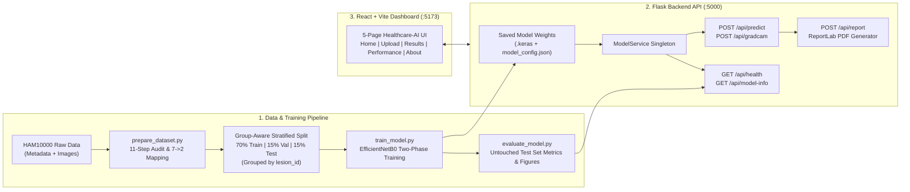

# Skin Disease Classification Using Deep Learning on the HAM10000 Dataset

**Final-Year B.Tech Artificial Intelligence & Machine Learning Major Project**  
**Institution:** Graphic Era Hill University, Dehradun, Uttarakhand  
**Department:** Department of Computer Science and Engineering  
**Project Team ID:** `CSE27-304`  
**Faculty Guide:** Nishant Bhandari, Assistant Professor  

---

## 1. Project Overview

This project implements a complete, end-to-end computer vision and explainable deep learning system for analyzing dermoscopic skin lesion images from the **HAM10000** (*Human Against Machine with 10000 training images*) dataset. Rather than exposing raw 7-class research codes directly to end users, the system performs clinically grounded **binary triage classification**:

- **Class 0 — Benign (Non-cancerous):** `nv`, `bkl`, `df`, `vasc`
- **Class 1 — Malignant (Cancerous / In-situ Neoplastic):** `mel`, `bcc`, `akiec`

The system encompasses:
1. **Leakage-Resistant Data Preparation (`scripts/prepare_dataset.py`):** 11-step dataset audit, missing-value and duplicate verification, explicit 7-to-2 clinical mapping, and **group-aware stratified splitting** grouped by `lesion_id` (70% Train / 15% Validation / 15% Test) so multiple images of the same lesion never cross split boundaries.
2. **Standardized Image Preprocessing (`backend/services/preprocessing.py`):** 3-channel RGB conversion, $224 \times 224$ bilinear resizing, `EfficientNetB0` preprocessing, and training-only data augmentation.
3. **Two-Phase Transfer Learning (`scripts/train_model.py`):** Pretrained `EfficientNetB0` backbone with `GlobalAveragePooling2D -> Dropout(0.35) -> Dense(1, sigmoid)`, inverse-frequency class weights, `ReduceLROnPlateau`, `EarlyStopping`, and validation-set decision threshold optimization.
4. **Untouched Test-Set Evaluation (`scripts/evaluate_model.py`):** Computes Accuracy, Precision, Recall (Malignant Sensitivity), Specificity ($\frac{TN}{TN + FP}$), F1-score, ROC-AUC, PR-AUC, and saves 6 publication-quality plots in `results/figures/`.
5. **Explainable AI via Grad-CAM (`backend/services/gradcam.py`):** Computes spatial activation heatmaps from the `top_activation` convolutional layer of `EfficientNetB0` and generates side-by-side comparisons and alpha-blended overlays.
6. **Flask REST API & PDF Report Engine (`backend/app.py`, `backend/services/report_service.py`):** Serves predictions, Grad-CAM visualizations, evaluation figures, and downloadable `ReportLab` PDF clinical research reports.
7. **React + Vite Healthcare Dashboard (`frontend/`):** 5-page responsive web interface with `Recharts` visualizations and `Lucide React` icons.

---

## 2. Problem Statement

Cutaneous malignancies—including malignant melanoma (`mel`), basal cell carcinoma (`bcc`), and squamous cell carcinoma in situ (`akiec`)—pose significant morbidity and mortality risks when detected late. Dermoscopic examination improves visual assessment, yet benign and malignant pigmented lesions frequently share overlapping morphological features. Furthermore, many academic deep learning implementations suffer from:
1. **Data leakage across splits** when multiple images of the same physical lesion (`lesion_id`) are randomly distributed across training and testing sets.
2. **Lack of explainability**, offering black-box probabilities without showing which spatial regions influenced the neural network.

---

## 3. Objectives

1. Audit the official HAM10000 metadata and construct a transparent, clinically justified mapping from the 7 diagnostic categories to **Benign (0)** and **Malignant (1)**.
2. Prevent data leakage by implementing group-aware stratified dataset splitting (`StratifiedGroupKFold` on `lesion_id`).
3. Train and fine-tune an `EfficientNetB0` binary classifier addressing the ~4.13:1 class imbalance via balanced class weights and validation-tuned decision thresholds.
4. Evaluate the trained model strictly on the untouched 15% test split, reporting Malignant Recall (Sensitivity), Specificity, Precision, F1-score, and ROC-AUC.
5. Provide real-time **Grad-CAM** visual explanations and downloadable **PDF prediction reports** through a full-stack Flask + React web application.

---

## 4. System Architecture



---

## 5. Dataset Acquisition Instructions

In compliance with repository hygiene rules, raw dataset images are not committed to Git. Obtain the official **HAM10000** dataset legally from one of the official sources:

1. **Harvard Dataverse (Official Primary Repository — Tschandl et al., 2018):**  
   `https://doi.org/10.7910/DVN/DBW86T`
2. **ISIC Challenge 2018 Archive (Task 3):**  
   `https://challenge.isic-archive.com/data/#2018`
3. **Kaggle Mirror (Skin Cancer MNIST: HAM10000):**  
   `https://www.kaggle.com/datasets/kmader/skin-cancer-mnist-ham10000`

---

## 6. Dataset Directory Format

Place the downloaded files inside `data/raw/` as follows:

```text
data/
├── raw/
│   ├── HAM10000_metadata.csv
│   ├── HAM10000_images_part_1/
│   │   ├── ISIC_0024306.jpg
│   │   └── ...
│   └── HAM10000_images_part_2/
│       ├── ISIC_0029306.jpg
│       └── ...
└── processed/
    ├── class_mapping.json
    ├── dataset_audit_summary.json
    ├── full_metadata_mapped.csv
    ├── train_split.csv
    ├── val_split.csv
    └── test_split.csv
```

*(Note: `scripts/prepare_dataset.py` recursively indexes `.jpg`, `.jpeg`, and `.png` files anywhere inside `data/raw/`, so images may reside in `HAM10000_images_part_1/`, `HAM10000_images_part_2/`, or directly inside `data/raw/`.)*

---

## 7. Label-Mapping Methodology (7 Classes $\rightarrow$ Binary)

| Original Code (`dx`) | Full Diagnostic Name | Binary Label | Binary Class | Clinical Rationale & Ambiguity Note |
| :--- | :--- | :---: | :---: | :--- |
| **`mel`** | Melanoma | `1` | **Malignant** | Unambiguous malignant melanocytic neoplasm with high metastatic potential. |
| **`bcc`** | Basal cell carcinoma | `1` | **Malignant** | Unambiguous malignant epithelial skin cancer; locally invasive and destructive. |
| **`akiec`** | Actinic keratoses & intraepithelial carcinoma / Bowen's disease | `1` | **Malignant** | **Ambiguity Note:** Includes Bowen's disease (squamous cell carcinoma *in situ*) and actinic keratoses (dysplasia capable of progressing to invasive SCC). Grouped under **Malignant** in binary triage because it requires clinical intervention/biopsy. |
| **`nv`** | Melanocytic nevi | `0` | **Benign** | Benign melanocytic proliferations (common moles); ~67% of HAM10000. |
| **`bkl`** | Benign keratosis-like lesions (seborrheic keratosis, solar lentigo, LPLK) | `0` | **Benign** | Biologically benign epidermal proliferations with no malignant potential. |
| **`df`** | Dermatofibroma | `0` | **Benign** | Unambiguous benign fibrohistiocytic dermal nodule. |
| **`vasc`** | Vascular lesions (angiomas, angiokeratomas, pyogenic granulomas, hemorrhage) | `0` | **Benign** | Non-malignant cutaneous vascular proliferations and subcorneal hemorrhage. |

---

## 8. Installation & 9. Virtual Environment Setup (macOS)

Open a terminal in the project root directory (`/Users/harshitsrikoti/Downloads/majo_pro`) and run:

```bash
# 1. Create a Python 3.11 virtual environment
/opt/homebrew/opt/python@3.11/bin/python3.11 -m venv .venv

# 2. Activate the virtual environment
source .venv/bin/activate

# 3. Upgrade pip and install all Python dependencies
pip install --upgrade pip
pip install -r requirements.txt

# 4. Install React frontend dependencies
npm --prefix frontend install
```

---

## 10. Separate Guide: Model Training Instructions

Once the HAM10000 dataset files are placed in `data/raw/`:

```bash
# Step 1: Activate the Python virtual environment
source .venv/bin/activate

# Step 2: Run the 11-step Dataset Audit, Binary Mapping & Group-Stratified Split
python scripts/prepare_dataset.py

# Step 3: Train the EfficientNetB0 model (Phase 1 Head + Phase 2 Fine-Tuning)
python scripts/train_model.py --head-epochs 8 --finetune-epochs 12 --batch-size 32
```

Saved training artifacts:
- `backend/models/efficientnetb0_ham10000_binary.keras` (Best checkpoint by `val_auc`)
- `backend/models/model_config.json` (Hyperparameters, class weights, and validation-selected decision threshold)
- `results/training_history/training_history.csv` & `training_history.json`
- `results/figures/augmentation_samples.png`

---

## 11. Model Evaluation Instructions

Evaluate the trained checkpoint strictly on the untouched 15% test split (`data/processed/test_split.csv`):

```bash
source .venv/bin/activate
python scripts/evaluate_model.py
```

Saved evaluation outputs:
- `results/metrics/evaluation_metrics.json` (Accuracy, Precision, Recall, Specificity, F1-score, ROC-AUC, PR-AUC, Confusion Matrix, sample counts)
- `results/metrics/test_predictions_audit.csv` (Per-sample test predictions for false-negative auditing)
- `results/figures/training_val_accuracy.png`
- `results/figures/training_val_loss.png`
- `results/figures/confusion_matrix.png`
- `results/figures/roc_curve.png`
- `results/figures/precision_recall_curve.png`
- `results/figures/class_distribution.png`

---

## 12. Backend Setup & 13. Frontend Setup (Starting the Web Application)

### Terminal 1 — Start the Flask Backend API (`http://127.0.0.1:5000`)

```bash
source .venv/bin/activate
python backend/app.py
```

### Terminal 2 — Start the React + Vite Frontend (`http://localhost:5173`)

```bash
npm --prefix frontend run dev
```

Open **`http://localhost:5173`** in your browser.

### Running from VS Code

1. Open the repository folder in **VS Code**.
2. Select `.venv/bin/python` as the Python Interpreter (`Cmd + Shift + P` $\rightarrow$ **Python: Select Interpreter**).
3. Open two integrated terminals (`Ctrl + Shift + ~`):
   - In Terminal 1, run `.venv/bin/python backend/app.py`.
   - In Terminal 2, run `npm --prefix frontend run dev`.
4. To explore the interactive notebooks (`notebooks/01_dataset_audit.ipynb` through `04_model_evaluation.ipynb`), open any `.ipynb` file in VS Code and select the `.venv` kernel.

---

## 14. API Documentation

| Endpoint | Method | Description | Request Payload | Response |
| :--- | :---: | :--- | :--- | :--- |
| `/api/health` | `GET` | Health check and model readiness | None | `200 OK` JSON (`status`, `model_loaded`, `model_architecture`) |
| `/api/model-info` | `GET` | Model architecture, threshold, 7-to-2 mapping, and test-set evaluation metrics | None | `200 OK` JSON |
| `/api/predict` | `POST` | Binary inference (`Benign` vs `Malignant`) + Grad-CAM generation | `multipart/form-data` (`image` file) | `200 OK` JSON (`predicted_class`, `benign_probability`, `malignant_probability`, `confidence_score`, `decision_threshold`, `visualizations`) |
| `/api/gradcam` | `POST` | Standalone Grad-CAM generation for an uploaded image | `multipart/form-data` (`image` file) | `200 OK` JSON (or `image/png` with `?format=image`) |
| `/api/report` | `POST` | Generate downloadable PDF prediction report | `application/json` (`prediction_id`) or `multipart/form-data` (`image`) | `200 OK` `application/pdf` attachment |

---

## 15. Running the Automated Test Suite (`pytest`)

```bash
source .venv/bin/activate
pytest backend/tests/ -v
```

The test suite verifies:
- 7-to-2 dataset label mapping consistency and invalid label rejection
- Zero `lesion_id` leakage across group-stratified Train/Val/Test splits
- RGB conversion and $224 \times 224$ preprocessing
- Pre-inference model file existence checks
- Valid image prediction and `benign_probability + malignant_probability == 1.0`
- Graceful `400 Bad Request` handling on missing, corrupt, tiny, or invalid-extension uploads
- Grad-CAM heatmap and overlay generation on `EfficientNetB0`
- ReportLab PDF generation (`%PDF-` verification)
- Confusion-matrix Specificity calculation and non-test split rejection guard

---

## 16. Troubleshooting

- **`Trained model file not found` (HTTP 503 on `/api/predict`):**  
  Ensure you have placed the HAM10000 dataset in `data/raw/` and run `python scripts/prepare_dataset.py` followed by `python scripts/train_model.py`.
- **`Cannot reach the Flask backend API` in React UI:**  
  Confirm `python backend/app.py` is running on port `5000` (`http://127.0.0.1:5000/api/health`).
- **SSL Certificate Error when downloading ImageNet weights on macOS:**  
  Ensure `certifi` is installed in `.venv` (`pip install certifi`) or pass `--weights none` for offline architecture testing.

---

## 17. Limitations & 18. Future Enhancements

- **Dataset Population Bias:** HAM10000 predominantly represents fair skin phototypes (Fitzpatrick I–III) from Austrian and Australian clinics; external clinical validation across diverse global skin tones is required.
- **Dermoscopic Modality Specificity:** Trained exclusively on dermatoscopic images; macroscopic smartphone photos have different optical properties and artifacts.
- **Probability Calibration:** Raw sigmoid outputs are uncalibrated confidence estimates, not true clinical post-test probabilities.
- **Future Enhancements:** Multi-modal fusion with patient metadata (age, sex, localization), automated hair/ruler artifact removal, temperature-scaled probability calibration, and evaluation on Fitzpatrick17k / DDI datasets.

---

## 19. Project Team Details

- **Institution:** Graphic Era Hill University, Dehradun, Uttarakhand
- **Department:** Department of Computer Science and Engineering
- **Project Title:** Skin Disease Classification Using Deep Learning on the HAM10000 Dataset
- **Faculty Guide:** Nishant Bhandari, Assistant Professor
- **Project Team ID:** `CSE27-304`
- **Project Team Members:**
  - **Kamal Kant Bisht** — Roll No: `2318930`
  - **Lakshya Tiwari** — Roll No: `2319035`
  - **Harshit Srikoti** — Roll No: `2318847`
  - **Manish Tinsola** — Roll No: `2319073`

---

## 20. Medical Disclaimer

> **IMPORTANT MEDICAL SAFETY DISCLAIMER:**  
> This software is an educational and academic research prototype developed at Graphic Era Hill University (Team `CSE27-304`). Predictions are experimental, uncalibrated estimates and may be incorrect. This system is **NOT** a clinically validated diagnostic device and is **NOT** a substitute for professional examination by a qualified dermatologist. A **Benign** prediction does not rule out skin cancer, and a **Malignant** prediction does not confirm skin cancer. Users must never make medical or treatment decisions based on this application. Any concerning skin lesion should be evaluated promptly by a qualified healthcare professional.
